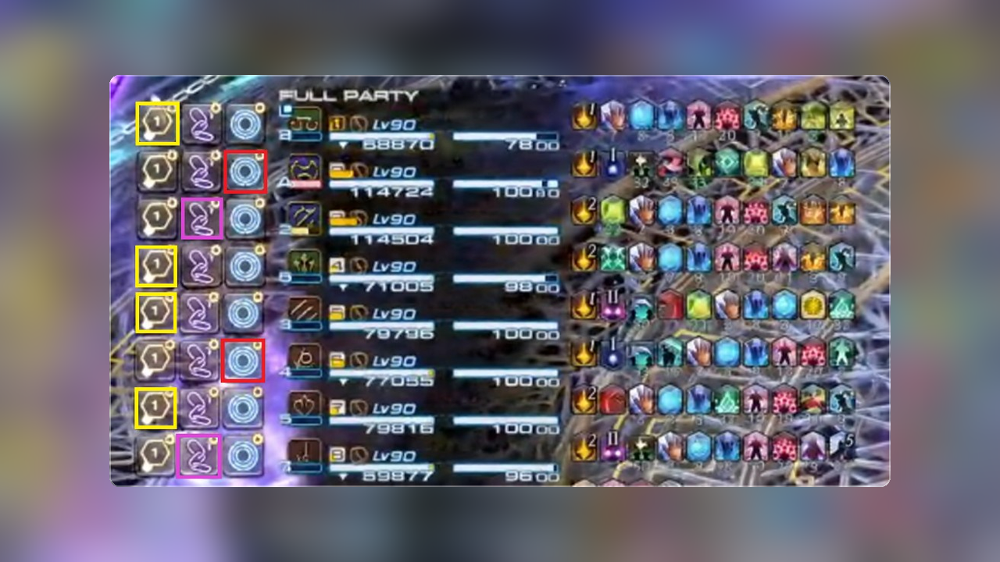

<p align="center">
  
</p>

<h1 align="center">Goetia</h1>

<p align="center">
  English | <a href="docs/README.ja.md">日本語</a>
</p>

<p align="center">
  <a href="https://github.com/exatrines/Goetia/releases/latest">
    
  </a>
  <a href="CHANGELOG.md">
    
  </a>
  <a href="LICENSE">
    
  </a>
</p>

<p align="center">
  
</p>

Goetia is a Dalamud plugin for **manual mark assist**. It highlights Attack / Bind / Stop hotbar slots in party list order (`<1>`–`<8>`).

Goetia never issues `/mk`. Place `/mk` macros on the assigned hotbars yourself. Map hotbars and slots in settings, enable the modules you need, and the matching slots light up during combat.

## Install

1. Run `/xlsettings` and open the **Experimental** tab
2. Add this URL under **Custom Plugin Repositories**:

```
https://raw.githubusercontent.com/exatrines/DalamudPlugins/refs/heads/main/pluginmaster.json
```

3. Run `/xlplugins` and install **Goetia**

## Features

- **Hotbar mapping** — `/goetia settings` maps Attack / Bind / Stop hotbars and the `<1>` origin slot. Assign three hotbars so eight consecutive slots follow party list order `<1>`–`<8>`. Example: hotbars 6 / 7 / 8, slots 5–12.
- **Preview overlay** — Optional overlay of party seats and hotbars, and which module is driving highlights (open from the main window Eye, or Preview in settings; close with × to turn off).

## Modules

Open `/goetia` and turn on the modules you use.

### TOP (The Omega Protocol)

Default assignment for each module:

#### Run Dynamis Delta

1. Near World / Far World (2 players) → `Stop`

#### Run Dynamis Sigma

1. Near World / Far World (2 players) → `Stop`
2. Dynamis ×1 (up to 2 players) → `Bind`
3. Remaining 4 players → `Attack`

#### Run Dynamis Omega (first half)

1. First in Line (2 players) → `Stop`
2. Second in Line with Dynamis ×2 → `Bind`
3. Fill remaining Bind slots from Dynamis ×2 so Bind totals 2
4. Remaining 4 players → `Attack`

#### Run Dynamis Omega (second half)

1. Near World / Far World (2 players) → `Stop`
2. Dynamis ×3 (2 players) → `Bind`
3. Remaining 4 players → `Attack`

### DSR (Dragonsong's Reprise)

Default assignment for each module:

#### Wrath of the Heavens

1. Thunderstruck (2 players) → `Stop`

#### Wroth Flames

1. Spreading Flames (4 players) → `Attack`
2. Entangled Flames (2 players) → `Bind`
3. Remaining 2 players → `Stop`

## Commands

| Command | Description |
| --- | --- |
| `/goetia` | Toggle the main window (module list) |
| `/goetia settings` | Toggle plugin settings (`config` / `s` also work) |

## For developers

1. `git submodule update --init --recursive`
2. Build: `dotnet build Goetia.sln -c Release -p:Platform=x64`
3. Point Dalamud’s **dev plugin** path at `Goetia/bin/Release/`
4. Enable **Goetia** in the plugin installer (dev)

[MirageUI](https://github.com/exatrines/MirageUI) is included as a git submodule for the shared UI kit.

## Contributing

Contributions are always welcome! Please see the [contribution guide](CONTRIBUTING.md).
